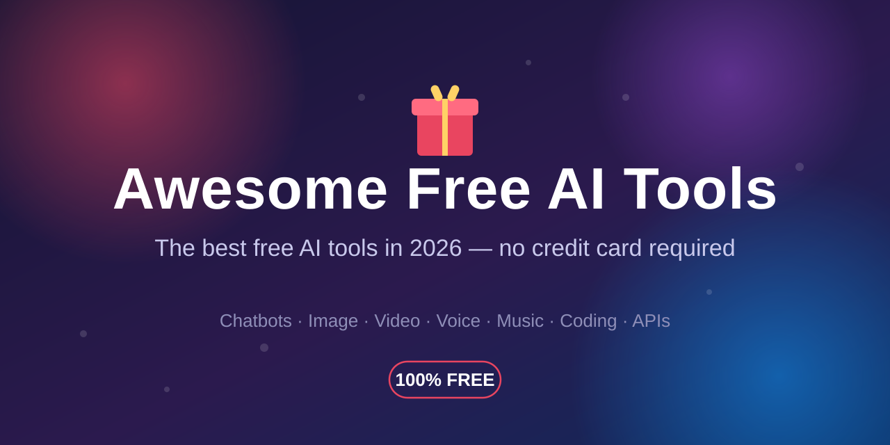

  
  <h1>Awesome Free AI Tools</h1>
    
  
  
  
  
  
    

> Curated list of the best free AI tools in 2026 — every tool has a genuinely usable free tier, no credit card required.

Free AI tools in 2026 are better than most paid plans were in 2024. This list only includes tools with a **genuinely usable free tier** — no credit-card walls, no fake "free trials" that expire in 7 days. Every entry notes what the free tier actually gives you.

## Contents

- [AI Chatbots & Assistants](#ai-chatbots--assistants)
- [AI Search & Research](#ai-search--research)
- [AI Image Generation](#ai-image-generation)
- [AI Video Creation & Editing](#ai-video-creation--editing)
- [AI Voice & Music](#ai-voice--music)
- [AI Coding Assistants](#ai-coding-assistants)
- [AI Productivity](#ai-productivity)
- [Free AI APIs for Developers](#free-ai-apis-for-developers)

## AI Chatbots & Assistants

- [ChatGPT](https://chat.openai.com) - Free tier with unlimited text chats on GPT-5.
- [Claude](https://claude.ai) - Free tier, great for writing and long documents; limits reset periodically.
- [Gemini](https://gemini.google.com) - Free tier includes Deep Research, image generation and Google Workspace integration.
- [DeepSeek](https://chat.deepseek.com) - Free chat with strong reasoning models.
- [Qwen](https://chat.qwen.ai) - Free app: chat, image generation, deep research agent and voice.
- [Mistral Le Chat](https://chat.mistral.ai) - Free European chatbot, fast and multilingual.
- [Microsoft Copilot](https://copilot.microsoft.com) - Free with a Microsoft account, web-connected answers.

## AI Search & Research

- [Perplexity](https://www.perplexity.ai) - AI search engine with cited, real-time answers; free tier with limited Pro searches.
- [NotebookLM](https://notebooklm.google.com) - Google's free research assistant: upload sources, get summaries and study guides.
- [Gemini Deep Research](https://gemini.google.com) - Multi-step research agent included in Gemini's free tier.

## AI Image Generation

- [Microsoft Designer](https://designer.microsoft.com) - Free AI image generation (Bing Image Creator), easiest start.
- [Leonardo.ai](https://leonardo.ai) - Daily free tokens for concept art and social graphics.
- [Ideogram](https://ideogram.ai) - Free tier, best-in-class text rendering inside images.
- [Adobe Firefly](https://firefly.adobe.com) - Free tier with commercially safer outputs.
- [Pollinations.ai](https://pollinations.ai) - Free AI image API, no signup required.

## AI Video Creation & Editing

- [CapCut](https://www.capcut.com) - Free AI video editing: auto-captions, background removal, smart cuts.
- [Kling](https://klingai.com) - Free tier for AI video generation.
- [Hailuo AI](https://hailuoai.video) - Free tier video generation from MiniMax.

## AI Voice & Music

- [edge-tts](https://github.com/rany2/edge-tts) - Free, open-source text-to-speech via Microsoft Edge voices.
- [ElevenLabs](https://elevenlabs.io) - Best AI voice generation; free tier gives ~10,000 characters/month.
- [QuietTake Noise Remover](https://noiseremover.site/) - Free RNNoise/WASM speech noise reduction in the browser with original/cleaned playback and 48 kHz 16-bit WAV export; each file must be 50 MB or smaller and five minutes or shorter, with no account or audio upload required.
- [Suno](https://suno.com) - Free AI music generation with daily credit refills.

## AI Coding Assistants

- [GitHub Copilot](https://github.com/features/copilot) - Free tier for individuals with limited completions.
- [Cursor](https://cursor.com) - Free hobby tier for the AI-first code editor.
- [Windsurf](https://windsurf.com) - Free tier AI coding assistant (formerly Codeium).

## AI Productivity
- [AI 만화 번역기](https://www.mangatranslate.com/ko/ai-manga-translator/) — Ficory LLC의 기업급 만화 리더는 개인의 일괄·맞춤 번역, 스튜디오용 완전한 온라인 Photoshop 스타일 편집기, 개인 작업 흐름용 API 연동과 제품이 지원하는 모든 번역 언어를 제공하며, 일일 출석으로 받는 무료 크레딧 안에서 번역을 체험할 수 있습니다.

- [Canva AI](https://www.canva.com) - Free tier with Magic Studio AI design credits.
- [Zapier](https://zapier.com) - Free tier: 100 automated tasks/month, now with AI steps.
- [Otter.ai](https://otter.ai) - Free basic plan for AI meeting notes and transcription.
- [Gamma](https://gamma.app) - Free one-time credits for AI-generated presentations and sites.
- [v0.dev](https://v0.dev) - Free tier for generating UI with AI.
- [Bolt.new](https://bolt.new) - Free tier for building apps with AI prompts.

## Free AI APIs for Developers

- [Google Gemini API](https://aistudio.google.com) - Generous free tier for the Gemini models.
- [Groq](https://groq.com) - Free tier with extremely fast LLM inference.
- [OpenRouter](https://openrouter.ai) - Access free open-weight models through one API.
- [Mistral API](https://console.mistral.ai) - Free API key available from the Mistral console.
- [OVHcloud AI Endpoints](https://www.ovhcloud.com/en/public-cloud/ai-endpoints/) - Free tier, no registration for anonymous use.
- [Requesty](https://www.requesty.ai/free-models) - 200 free requests/day, OpenAI-compatible.

## Contributing

Contributions are welcome! Please read the [contribution guidelines](CONTRIBUTING.md) first. To be listed, a tool must have a **genuinely free tier** — no credit card required.

To the extent possible under law, [bilalsyr](https://github.com/bilalsyr) has waived all copyright and related or neighboring rights to this work.
